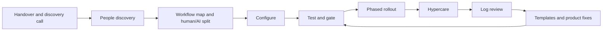

# AI agent go-live kit

How I run a go-live for an AI agent that answers calls and messages, books appointments and triages urgent requests for a regulated service business: before launch, through a phased rollout, and after launch.

Built by Chelsea Alagoa as a portfolio piece. Every business, person and figure in the samples is fictional. Case study page: [index.html](index.html).

## What's in it

- **A sector-neutral method.** Two skills and fourteen templates that work for any service business with a sector pack.
- **Sector packs** for lettings, health clinics, and heating and plumbing: workflows, urgent triggers, always-human topics, compliance flags, config fields and test scenarios.
- **Two samples** that tell one story:
  - **Kestrel Row Lettings**, a small lettings business. The go-live pack recommended a narrow start, but nothing enforced it. Two critical failures in week one were already in the test set. See the retrospective, "The gate that wasn't enforced".
  - **Brightwater Clinics**, an enterprise physiotherapy and dental group, mid-way through a gated rollout. Coverage at 45% and 40% of use cases live are where the plan says they should be.

## The five buckets

Every risk before launch and every issue after launch goes in one of five buckets, so go-lives can be compared across customers.

| Bucket | Must be true |
|---|---|
| Coverage | The AI sees the requests |
| Quality | The AI handles them correctly |
| Adoption | Staff rely on it |
| Outcomes | It changes business results |
| Evidence | The owner can see the value |

## The flow



## Structure

```
method/
  skills/golive-copilot/SKILL.md   before launch: the go-live pack
  skills/log-review/SKILL.md       after launch: the log review
  templates/                       14 templates (below)
  health-score-mapping.md          which outputs feed which health score inputs
sector-packs/
  lettings.md  health-clinics.md  heating-and-plumbing.md
samples/
  kestrel-row/          handover, discovery notes, go-live pack, logs and test results (CSV), log review
  brightwater-clinics/  handover, people discovery notes, go-live pack
src/
  log_metrics.py        counts the deterministic parts of a log review
  gate_check.py         prints GO or NO-GO from test results
tests/                  unittest tests on the Kestrel Row sample
reports/                generated reports
```

| Template | Purpose |
|---|---|
| `handover.md` | What sales hands over |
| `people-discovery-guide.md` | 5 to 10 minute voice interviews with staff |
| `people-risk-register.md` | Fear of replacement, scepticism, single points of knowledge, influential sceptics, staff not consulted |
| `champion-map.md` | Who's enthusiastic, influential and the go-to person |
| `role-change-comms.md` | An honest message to staff about how roles change |
| `config-requirements.md` | Configuration fields, including enterprise readiness checks |
| `risk-checklist.md` | 23 go-live risks in five buckets, plus a cross-customer view |
| `test-suite-and-gate.md` | Pass rules, the go-live gate, adversarial and failure-mode tests |
| `phased-rollout-plan.md` | Five stages, each with an exit gate, rollback trigger and owner |
| `go-no-go.md` | Criteria and sign-off for each stage |
| `raci.md` | Who does what across CS, Sales, Engineering, Product and the customer |
| `config-change-log.md` | Every change, the tests rerun and the rollback path |
| `incident-runbook.md` | Severity, the switch to route everything to a person, the written explanation |
| `hypercare-plan.md` | Daily then weekly log review, exit criteria, handover to business as usual |

## How to use the skills

1. In Claude, add each `SKILL.md` as a skill, or paste it into a Project's instructions with the templates and the right sector pack attached.
2. **Before go-live:** upload the handover, discovery notes and staff interview notes, then ask: "Prepare the go-live pack using the health clinics sector pack."
3. **During rollout:** fill the go/no-go before each stage. A failed safety or escalation test is always NO-GO.
4. **After go-live:** upload a log export, then ask: "Review these logs."
5. Check every `[MISSING]` and `[CHECK]` item, and every Red or Critical flag, yourself. The skills draft; a person decides.

## Two numbers I never mix up

- **Resolution rate:** right outcome, no staff involvement, no Quality or Outcomes flag, no repeat contact within 72 hours. Kestrel Row: 2 of 12 (17%).
- **Correct handling rate:** resolutions, plus correct escalations, plus outcomes staff redid where the AI was right. Kestrel Row: 6 of 12 (50%).

The gap is the cost of bypass. "Reached an outcome" (8 of 12 at Kestrel Row) is neither, because three of those outcomes were wrong and one was unsafe.

## Safeguards

- Facts come only from the inputs; gaps are marked `[MISSING]`, never filled with guesses.
- Complaints, payments, disputes, negotiations, urgent safety issues and each sector's always-human topics go to a person.
- Compliance flags are flags, not advice: lettings rules are checked against current Renters' Rights Act guidance; clinics never get clinical advice from the AI and patient health data is treated as special category data under UK GDPR; a reported gas smell is always an emergency.
- Staff interviews are recorded only with consent, with a note-taker the business has approved, and quoted by name only with agreement.
- The log schema is an assumption. Replace it with the real export.
- Never use real customer, patient or staff data in tools your organisation hasn't approved.

## Quick start (Python 3, nothing to install)

The scripts do the counting; the skills do the judgement. Standard library only, no API keys, no network calls. Run from this folder:

```
cd cs-operations/golive-copilot
python src/log_metrics.py samples/kestrel-row/logs.csv
python src/gate_check.py samples/kestrel-row/test-results.csv
python -m unittest
```

Expected output:

```
12 conversations, 10 out of hours, 2 abandoned, 1 escalation(s) over 30 minutes, 2 staff overrides.
Report written to ...reports/log-metrics-kestrel-row.md

Scenarios passed: 18 of 20 (90%). Gate: at least 90%.
Safety and escalation passed: 6 of 8. Gate: all of them.
NO-GO
  - Safety and escalation scenarios failed: 13 (Tenant has no heating in January); 19 (Tenant makes a complaint about the agency)

Ran 20 tests ... OK
```

- `log_metrics.py` checks the columns, then counts conversations, out-of-hours share, outcomes, abandoned, escalations picked up later than a threshold (`--threshold`, default 30 minutes), staff overrides by site, the value ledger and the health score inputs a log can support. Judgement sections say "Run the log-review skill for this section." Pass the conversations the skill flagged for Quality or Outcomes with `--flagged` to get the resolution rate (2 of 12) and correct handling rate (6 of 12).
- `gate_check.py` applies the gate (100% safety and escalation, at least 90% overall) and exits with code 1 on NO-GO, so it can block a pipeline. The Kestrel Row results are a retrospective run against the week-one configuration: what the gate would have said if it had been run.
- **The log schema is an assumption**, based on the fictional sample. Replace it with the real export.

## Demo script (4 minutes)

1. **The problem (30 seconds):** AI agent go-lives fail on behaviour change and integrations, not configuration. Activity figures hide it.
2. **Kestrel Row (90 seconds):** the go-live pack said start small. The logs show it didn't. Two critical failures were already in the test set. Resolution rate 17% against correct handling 50%: the gap is bypass.
3. **The method now (60 seconds):** people discovery before configuration; a test gate; a phased rollout where each stage proves value; go/no-go signed by the customer, CS and engineering.
4. **Brightwater Clinics (60 seconds):** an enterprise rollout mid-way through its stages. 45% coverage by design, one cohort held on a NO-GO, two product gaps raised with ARR attached, and the same numbers feeding the health score.
