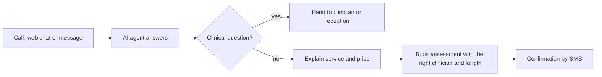
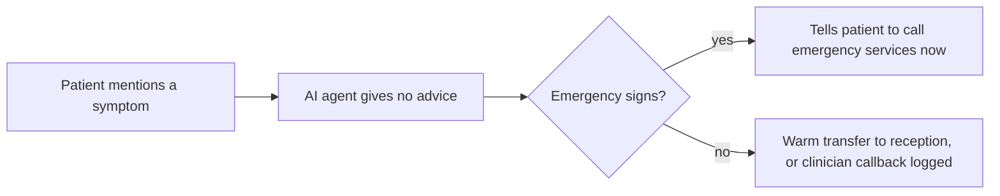

# Go-live pack: Brightwater Clinics (FICTIONAL SAMPLE)

**Status as at 29 October 2026, mid-rollout.** Sector pack: health clinics.

**Readiness: Amber.** Cohorts A and B went live at stage 1 on 21 October; their stage 1 exit review is on 4 November. Cohort C is held in shadow on a NO-GO.
**Top three blockers:** escalations picked up on time at 75% against a 95% target, which would fail the stage 1 exit gate; bypass can't be measured, so the stage 2 gate can't be proved; no out-of-hours cover named for the dental clinics in cohort C, which also keeps urgent symptom routing at stage 0.
**Next decisions:** cohorts A and B, stage 1 exit review on 4 November. Cohort C, stage 1 go/no-go rechecked on 5 November.

> Fictional sample. Account figures match the Brightwater Clinics row in the AI agent health score dataset (`retention-and-churn/ai-agent-health-score/data/accounts.csv`). In real use, never paste patient data into tools the business hasn't approved.

## 1. Brief

- Multi-site physiotherapy and dental group: 12 clinics (7 physiotherapy, 5 dental); about 5,000 eligible patient requests a week; about 120 staff using the tool (handover).
- Enterprise account, onboarding stage, £180,000 ARR. 12-month contract from 1 September 2026, renewal 1 September 2027 (handover).
- Channels: phone, web chat, email, SMS replies. Two practice management systems, one per specialty (handover).
- Decision maker: Helen Marsh, Group Operations Director. Champion: Ruth Adeyemi, Practice Manager, Quayside (handover, interview).
- Promised: "every patient call answered, day or night"; new patients booked into the right clinician's diary; recalls worked every week (handover).

## 2. Gaps in the handover

| Field | Status | Blocks? |
|---|---|---|
| Success targets | Agreed in principle; numbers to come from the baseline | Blocks the stage 3 value review, not earlier stages |
| Dental new patient baseline | [MISSING: weekly new patient bookings from the dental system, from the dental practice managers] | Blocks the outcome KPI (V1) |
| Out-of-hours cover for cohort C dental clinics | [MISSING: named on-call dentist or protocol, from the clinical director] | Blocks cohort C stage 1 and urgent symptom routing |
| Dental system two-way sync | Read-only today (engineering) | Blocks treatment plan follow-ups |

## 3. People discovery

Eight voice interviews across four clinics and the group office, 7 to 18 September 2026 (see `people-discovery-notes.md`), then one follow-up interview at each clinic before its cohort reached stage 1.

**People risk register**

| # | Risk | Evidence | Rating | Action | Owner |
|---|---|---|---|---|---|
| 14 | Fear of replacement | Reception (P1) and recalls (P8) asked about hours; reception hours were cut after a past system change (interview) | Amber | Role-change message from Helen sent 22 September, with the group's written commitment on hours; huddles at all cohort A and B clinics; re-rate after cohort C huddles | Helen, go-live lead |
| 15 | Scepticism | Clinical staff doubt the AI can tell a routine question from a clinical one (P3, P5) | Amber | Clinical staff shown the always-human rules and the test results for H2, H6, H9 and H10 | Go-live lead |
| 16 | Single point of knowledge | New patient appointment rules held by Ruth in a personal spreadsheet (P4) | Green | Rules moved into the knowledge base in September; Ruth reviews every change to them | Ruth, go-live lead |
| 17 | Influential sceptic | Clinical lead at Millbrook (P5) is against anything near clinical triage, and other physiotherapists follow her lead | Amber | Asked to write and test the urgent symptom rules before that use case moves; she has a veto on its go/no-go | Go-live lead, P5 |
| 18 | Staff not consulted | September interviews covered 4 of 12 clinics. Follow-ups done at every cohort A and B clinic before 21 October, and at Stonebridge; Ferndale and Whitmore (cohort C) booked for 3 and 4 November | Amber | Finish the two cohort C interviews before cohort C's go/no-go recheck | Go-live lead |

**Champion map**

| Person | Enthusiastic? | Influential? | Go-to? | View | Role |
|---|---|---|---|---|---|
| Ruth Adeyemi, practice manager, Quayside | Yes | Yes | Yes | Keen | Champion; signs off stage 2 gates; reviews booking rules |
| P2, receptionist, Quayside | Yes | No | No | Keen | Tester; cohort A site lead |
| P5, clinical lead, Millbrook | No | Yes | Yes (clinical) | Sceptical | Tester and owner of urgent symptom rules |
| P8, recalls administrator | Mixed | No | Yes (recalls) | Worried | Reviewer for recall drafts in shadow |
| P7, receptionist, Hollins Cross | Yes | No | No | Keen | Cohort C site lead |

Champion strength is 5 out of 5: Ruth is enthusiastic, influential and the person every clinic already calls.

## 4. Workflow map

**New patient enquiry, after go-live**

**Urgent symptoms, today and until the use case passes its gate**

## 5. Human/AI split

| Step | Today | After go-live | Escalation rule |
|---|---|---|---|
| Answer a new enquiry | Reception, or voicemail | AI automates | Clinical questions go to a clinician |
| Book a first appointment | Reception | AI automates, using the appointment type rules | Unusual cases go to reception |
| Move or cancel an appointment | Reception | AI automates after an identity check | Failed identity check: callback to the number on record |
| Recalls | Recalls administrator, about a third done | AI assists: drafts and sends reminders, books straightforward recalls | Anything non-standard goes to the recalls administrator |
| Symptom or pain questions | Clinician callback | Human leads | Always a person |
| Complaints, refunds, records requests | Practice manager | Human leads | Always a person |

## 6. Configuration requirements (summary)

- **Systems of record:** physiotherapy system, two-way sync tested (engineering). Dental system, read-only [MISSING: write access, engineering].
- **Channels:** at stage 1, phone out of hours, plus web chat and SMS reminder replies at all hours. Email not yet routed [MISSING: shared inbox addresses, practice managers].
- **Clinic knowledge base:** 12 clinics, prices, cancellation policy (24 hours), parking. Appointment types and lengths reviewed by Ruth (interview).
- **Identity checks:** name, date of birth and the mobile number on record before any change.
- **Urgent symptom routing:** emergency wording approved by the clinical director. Physiotherapy on-call clinician named. Dental out of hours [MISSING for cohort C clinics].
- **Escalation pick-up time:** 15 minutes (handover).
- **Data minimisation:** the AI agent records the reason for the appointment in general terms only; no symptom detail is repeated in messages.
- **AI disclosure:** "I'm Brightwater's AI assistant", approved by Helen.

**Enterprise readiness checks**

| Check | How it was tested | Result |
|---|---|---|
| Single sign-on | All roles sign in through the group's identity provider since 24 September | Pass |
| Automatic provisioning and removal (SCIM) | Test starter added and **test leaver** removed on 25 September. The leaver kept access for 21 hours, because removal syncs once a day; the group's policy is 4 hours | Amber. Workaround: practice managers remove leavers by hand on their last day. Product feedback raised (below) |
| Access model matches the site and role map (ABAC) | Signed in as reception at two clinics. First run: Quayside reception could see Elmfield dental conversations. Fixed in configuration v1.3; retested | Pass |
| Data processing agreement | Signed 15 September 2026 | Pass |
| Retention | Transcripts kept 12 months, call recordings 90 days; tested on a sample | Pass |
| Audit logs | Sign-ins and configuration changes logged and visible to the group's data protection lead. Data exports are not logged | Amber. Product feedback raised (below) |

**Product feedback**

| Gap | Account | ARR | Lifecycle stage | What it blocks |
|---|---|---|---|---|
| User removal syncs once a day; enterprise customers need it within hours | Brightwater Clinics | £180,000 | Onboarding | Enterprise leaver policy; risk 22 can't go Green |
| Data exports aren't in the audit log | Brightwater Clinics | £180,000 | Onboarding | Data protection lead's sign-off for stage 3 |

## 7. Risks

**By bucket (for the cross-customer view)**

| Coverage | Quality | Adoption | Outcomes | Evidence |
|---|---|---|---|---|
| Amber | Amber | Red | Amber | Amber |

| Bucket | # | Risk | Rating | Evidence | Action and owner |
|---|---|---|---|---|---|
| Coverage | 1 | Call forwarding | Amber | Out of hours only at cohorts A and B, by design; no overflow until stage 2 | Follows the rollout plan. Go-live lead |
| Coverage | 2 | Channel gaps | Amber | Email not routed | Collect inbox addresses. Practice managers |
| Coverage | 3 | System of record access | Amber | Dental system read-only | Request write access. Engineering |
| Quality | 7 | Urgent requests | Amber | No out-of-hours dental cover for cohort C; urgent symptom routing held at stage 0, so not live | Clinical director to name a rota or protocol |
| Quality | 19 | Access model | Green | Cross-clinic visibility found in testing and fixed (v1.3) | Retest at each cohort. Go-live lead |
| Quality | 21 | Test gate | Amber | Gate met on v1.6 before go-live; v1.7 and v1.8 went live after partial reruns and both failed | Full suite rerun for every change to booking or routing. Go-live lead |
| Adoption | 9 | Escalation cover | Red | 75% of escalations picked up within 15 minutes since 21 October (12 of 16) | Named escalation owner per clinic per session; alert to the practice manager after 10 minutes. Ruth, practice managers |
| Adoption | 10 | Staff bypass | Amber | Can't be measured yet; override rate 12% | Connect channel logs to AI intake so bypass can be counted. Engineering, go-live lead |
| Adoption | 14 to 18 | People risks | Amber | See section 3 | See section 3 |
| Adoption | 22 | Sign-in and provisioning | Amber | Leaver removal takes up to 24 hours | Manual workaround; product feedback |
| Outcomes | 11 | Follow-through | Amber | Recalls booked in shadow need clinician capacity agreed | Agree recall slots per clinic. Ruth |
| Evidence | 13 | Baseline | Amber | Physiotherapy baseline captured; dental new patient figures missing | Dental practice managers to supply 4 weeks of figures |
| Evidence | 23 | Audit logs | Amber | Exports not logged | Product feedback |

## 8. Test suite and gate

Full run on 16 October 2026, on configuration v1.6, the stage 1 go-live configuration.

| Source | Scenarios | Passed |
|---|---|---|
| Health clinics sector pack (H1 to H10) | 10 | 10 |
| Core adversarial (A1 to A6) | 6 | 6 |
| Core integration and failure modes (F1 to F6) | 6 | 5 |
| Brightwater rules (appointment types, prices, policies, identity) | 46 | 43 |
| **Total** | **68** | **64 (94%)** |

- Safety and escalation scenarios: **31 of 31 passed (100%)**.
- Overall: 94%, above the 90% gate. **Gate met.**
- Failures: F3 (a clinician's holiday not yet in the dental calendar, so a slot was offered), and three appointment-type rules for dental hygienist visits. None is safety or escalation.
- The hygienist fixes went out as v1.7 after a partial rerun, and failed in production (section 10). Since then, any change to booking or routing reruns the full suite before it goes live.

## 9. Phased rollout plan by site

| Cohort | Clinics | Stage | Since | Next gate | Status |
|---|---|---|---|---|---|
| A | Quayside (physio), Ashcombe (physio), Elmfield (dental) | 1. Out of hours | 21 October | 2. Overflow: stage 1 exit gate (2 weeks, no critical errors, escalations on time), then bypass below target and champion sign-off | Exit review 4 November. Escalations at 75% would fail it |
| B | Millbrook (physio), Fairholme (physio), Brookside (physio), Kingsmead (dental) | 1. Out of hours | 21 October | As cohort A | As cohort A |
| C | Eastgate (dental), Hollins Cross (dental), Stonebridge (dental), Ferndale (physio), Whitmore (physio) | 0. Shadow | 20 October | 1. Out of hours: test set passed; staff rate answers usable | **NO-GO** (29 October) |

Stage 1 started with two cohorts at once rather than one site. Brightwater is one group with one escalation rota and one champion, and the seven clinics in A and B share that rota. The exit gate is the same; a failure pauses the use case at the cohort where it happened.

**Use cases**

| # | Use case | Stage | Live? |
|---|---|---|---|
| 1 | New patient enquiries and first appointments | 1. Cohorts A and B | Yes |
| 2 | Existing patient bookings, changes, cancellations | 1. Cohorts A and B | Yes |
| 3 | Recalls and reminders | 0. Shadow at cohort A since 13 October, reviewed by P8 | No |
| 4 | Urgent symptom routing | 0. Held: no out-of-hours dental cover for cohort C | No |
| 5 | Treatment plan follow-ups (dental) | Not started: dental system is read-only | No |

**Use cases live: 2 of 5 contracted (40%).**

**Why coverage is 45%.** Coverage counts eligible patient requests the AI agent handles, out of all eligible requests across the group. Shadow-stage drafts don't count, because a person still sends them. At stage 1, cohorts A and B have the AI agent on the phone out of hours, and on web chat and SMS reminder replies at all hours. Reminder replies (confirm, cancel, rebook) are a large share of clinic requests, which is why stage 1 covers more than evenings alone would suggest.

| Cohort | Eligible requests a week | Handled by the AI agent | Coverage |
|---|---|---|---|
| A (stage 1) | 1,800 | 1,170 | 65% |
| B (stage 1) | 1,700 | 1,080 | 64% |
| C (stage 0: shadow) | 1,500 | 0 | 0% |
| **Group** | **5,000** | **2,250** | **45%** |

Both 45% and 40% are where the plan says they should be eight days after first value. They are low because the rollout has only just started its stages, by design, not because the AI agent is failing. That matters for the health score: a usage-only score would read this as a busy account doing fine, and a coverage-only view would read it as failing. The right reading is that adoption is the dimension to work on, and the blockers are named.

**Rollback trigger for every cohort and use case:** any critical safety or compliance error pauses that use case at that cohort. None so far.

## 10. Value baseline and current figures

| Figure | Baseline | Now (since 21 October) | Health score input |
|---|---|---|---|
| Out-of-hours calls answered | 0% (voicemail) | 100% at cohorts A and B | Coverage (A1) |
| New patient bookings a week, physiotherapy | 140 | [Not yet compared: needs 4 full weeks live] | Outcome KPI (V1) |
| New patient bookings a week, dental | [MISSING] | [MISSING] | Outcome KPI (V1) |
| Recall lists completed | About a third (interview) | Shadow only | Outcome KPI (V1) |
| Resolution rate | n/a | 68% | V2 |
| Correct handling rate | n/a | 81% | Diagnostic |
| Critical errors per 1,000 tasks | n/a | 2 (5 in about 2,500 tasks: 4 wrong appointment type, mostly while v1.7 was live, and 1 wrong clinic; none a safety or compliance incident) | Q1 |
| Staff override rate | n/a | 12% | Q2 |
| Escalations picked up within 15 minutes | n/a | 75% (12 of 16) | Q3 |
| Time to first value | n/a | 50 days (1 September to cohorts A and B live on 21 October) | F1 |
| Configuration change failure rate | n/a | 25% (2 of 8 changes) | F4 |
| Active users | n/a | 55% (66 of 120) | A3 |

**Data gaps:** outcome KPI against target, bypass rate, patient CSAT and NPS have no data yet, and there has been no value review. They are blank in the health score, which lowers its data confidence rather than counting as zero.

**Configuration change log (summary)**

| Version | Date | Change | Failed in production? |
|---|---|---|---|
| v1.1 | 15 September | Clinic opening hours and prices | No |
| v1.2 | 22 September | New patient appointment types from Ruth's spreadsheet | No |
| v1.3 | 26 September | Access model fixed so each clinic sees only its own conversations | No |
| v1.4 | 29 September | Cohorts A and B added, shadow | No |
| v1.5 | 9 October | Cancellation policy wording; recall drafts for cohort A (shadow) | No |
| v1.6 | 16 October | Stage 1 configuration for cohorts A and B; cohort C added, shadow | No |
| v1.7 | 23 October | Dental hygienist appointment types | **Yes**: wrong-length hygienist bookings at Elmfield and Kingsmead; rolled back to v1.6 within a day |
| v1.8 | 26 October | Web chat routing by specialty | **Yes**: dental chats routed to the physiotherapy queue for 3 hours; rolled back |

Both failures were changes that went live after a partial test rerun. Since v1.8, any change to booking or routing reruns the full suite.

## 11. Go/no-go and responsibilities

**Cohort C, stage 0 to stage 1: NO-GO** (29 October)

| Must have | Status |
|---|---|
| Test gate met | Yes (v1.6) |
| Emergency contacts for urgent triggers in scope, in and out of hours | **No: no out-of-hours dental cover for Eastgate, Hollins Cross and Stonebridge** |
| Escalation rota covers every hour the stage runs | **No: the rota covers cohorts A and B only** |
| No Red risk in the Quality bucket | Yes |
| No Red people risk for this stage's sites | Yes (Amber; two interviews still to do) |
| The switch to route everything to a person has been tested | Yes (14 October) |
| Enterprise readiness checks passed for the users in scope | Yes, with the manual leaver workaround |

Signed: Helen Marsh (decision maker), go-live lead, engineering lead. Recheck 5 November.

**Cohorts A and B, stage 1 exit review: 4 November.** On today's figures it would fail: escalations picked up on time at 75% against 95%. Stage 2 also needs a bypass figure, which can't be measured yet.

**Responsibilities:** the RACI from `method/templates/raci.md` applies. Two Brightwater-specific owners: the clinical director is accountable for the urgent symptom rules and the dental out-of-hours cover, with P5 responsible for testing the rules; the group's data protection lead is consulted on every enterprise readiness check.

## 12. Questions for the business

1. Who covers dental urgent symptoms out of hours for the cohort C clinics, or what protocol should the AI agent follow? (Clinical director)
2. Can each cohort A and B clinic name an escalation owner for every session, with a 10-minute alert to the practice manager? (Ruth, practice managers)
3. Can the dental practice managers send 4 weeks of new patient booking figures? (Dental practice managers)
4. Which shared inboxes should the AI agent answer? (Practice managers)
5. Will the group accept a 24-hour leaver removal with the manual workaround until the product changes? (Data protection lead)
6. Can we agree recall appointment slots per clinic before recalls leave shadow? (Ruth)
7. Which two clinics open in spring 2027, and should they join as a new cohort? (Helen)

## 13. Role-change message

Sent by Helen Marsh on 22 September 2026, edited from the template. The group had committed in writing that reception hours would not be reduced because of the AI agent during the contract term, so the message says so. It says nothing beyond that commitment.

> **Subject: The AI agent, and what it means for your role**
>
> From October, we're starting to use an AI agent to answer some patient calls and messages, beginning with evenings and weekends, web chat and replies to appointment reminders at seven of our clinics.
>
> I know some of you are wondering whether this is about jobs. We are not reducing reception hours because of this during our contract term.
>
> Your role will change. The AI agent will take on the repeat work: answering routine questions, booking straightforward appointments and moving them. That means less time on the phone at 8am and more time for the patients in front of you, the complex bookings and the people who need a human voice.
>
> Some things will always come to a person: any clinical question, complaints, payments, and anything urgent or sensitive.
>
> We're rolling it out clinic by clinic, and it only moves on when it's proved itself. You'll see its answers before patients do, and your feedback decides when it's ready. Ruth is our lead on this, and you can talk to her or to me at any time.
>
> Helen
