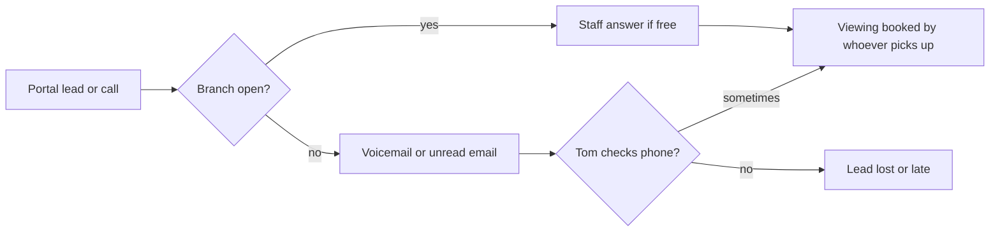
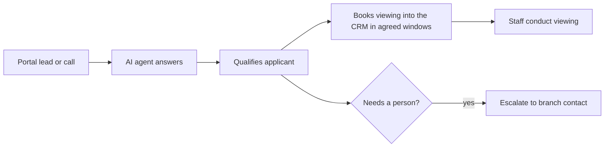
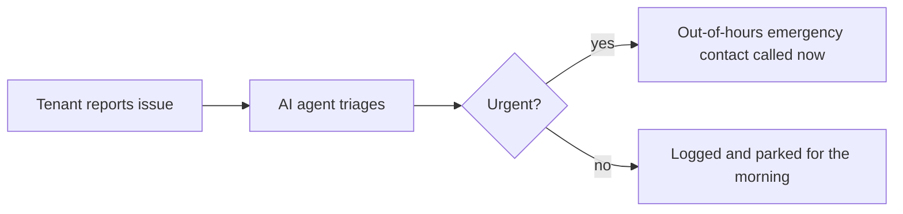

# Go-live pack: Kestrel Row Lettings (FICTIONAL SAMPLE)

**Readiness: Red.**
**Top three blockers:** price and go-live date not agreed in writing; calls only reach voicemail after four rings, with no forwarding plan; a qualification practice that may breach the Renters' Rights Act.
**Recommended go-live date:** not yet. Northfield, out of hours only, within 10 working days of the blockers being cleared.

> Sample built from invented inputs. In real use, do not paste tenant or landlord data into tools your organisation hasn't approved.
>
> This pack was made with the first version of the method, before the people discovery, phased rollout, test gate and go/no-go steps were added. Its recommendation was right; nothing enforced it. See the retrospective in `log-review.md`.

## 1. Brief

- Two Bristol branches (Northfield, Riverside); about 320 managed units and about 15 sales listings (handover).
- Channels in scope: phone, email, property portals. Messaging apps later (handover).
- CRM: a cloud lettings CRM. A CRM switch is planned for spring; supplier not chosen (handover, call).
- Decision maker: Priya Shah, Director. Proposed champion: Tom Reed, Lettings Manager, Northfield (handover).
- Promised: "never miss an out-of-hours enquiry", with viewings booked straight into the CRM (handover).

## 2. Gaps in the handover

| Field | Status | Blocks go-live? |
|---|---|---|
| Price | Not discussed | Yes (trial discipline) |
| Go-live date | Verbal only ("early next month") | Yes (trial discipline) |
| Success criteria | Agreed, but no targets or baseline | Yes, until targets are set |
| Call forwarding plan | Not covered | Yes |
| Riverside champion | None named; manager sceptical | No, but raises bypass risk |
| Out-of-hours escalation | Tom only, no rota | Yes for maintenance |

## 3. Workflow map

**Lettings enquiry, today**

Leak points: evenings and Sundays (call); calls going to voicemail after four rings in hours (handover).

**Lettings enquiry, after go-live**

**Maintenance, after go-live**

## 4. Human/AI split

**Lettings**

| Step | Today | After go-live | Escalation rule |
|---|---|---|---|
| Answer enquiry | Staff, or voicemail | AI automates | None |
| Qualify applicant | Staff | AI automates, using approved questions | Unusual circumstances go to a person |
| Book viewing | Whoever picks up | AI automates, within agreed windows | No slot available: offer callback |
| Conduct viewing | Staff | Human leads | n/a |
| Holding deposit, offers, negotiation | Staff | Human leads | Always a person |

**Sales and valuations**

| Step | Today | After go-live | Escalation rule |
|---|---|---|---|
| Valuation request | Priya's diary | AI assists: captures details, offers slots from Priya's diary [MISSING: calendar access] | Priya confirms |

**Maintenance**

| Step | Today | After go-live | Escalation rule |
|---|---|---|---|
| Report issue | Branch phone or email | AI automates triage | Urgent safety issue: call emergency contact immediately |
| Assign contractor | Staff, from spreadsheet | AI assists [MISSING: contractor list in a usable form] | Staff confirm |

## 5. Configuration requirements

- **CRM:** cloud lettings CRM (handover). Two-way sync [MISSING: confirm with engineering].
- **Phone forwarding:** [MISSING]. Recommend "all calls out of hours" for the trial, then review in-hours overflow.
- **Email inboxes:** [MISSING: addresses per branch].
- **Portals:** property portals in scope (handover). Routing [MISSING].
- **Messaging apps:** out of scope for the trial (handover).
- **Viewing windows:** Northfield: Tuesday and Thursday evenings, Saturday mornings (call). Riverside: [MISSING: no set windows].
- **Holding deposit:** one week's rent (call).
- **Fees:** [MISSING: current fees; website "a bit out of date" (call)].
- **Pet policy:** varies by landlord (call). The AI agent should say it depends on the property and take the details.
- **Qualification questions:** income, move date, pets, number of occupants (call). Remove any filtering on benefits (see risk 6).
- **Urgent maintenance:** [MISSING: emergency contact and contractor routing].
- **Escalation:** Tom, in and out of hours (call). [MISSING: Riverside contact; weekend rota].
- **AI disclosure:** [MISSING: wording approved by Priya].
- **Reporting:** weekly value summary to Priya and Tom (proposed).

## 6. Risks

**By bucket (for the cross-customer view)**

| Coverage | Quality | Adoption | Outcomes | Evidence |
|---|---|---|---|---|
| Red | Red | Red | Amber | Red |

| Bucket | # | Risk | Rating | Evidence | Action and owner |
|---|---|---|---|---|---|
| Coverage | 1 | Call forwarding | Red | Voicemail after four rings; no plan (handover) | Agree forwarding mode with Priya. Go-live lead |
| Coverage | 2 | Channel gaps | Amber | Portals and email routing unknown | Collect addresses and set up routing. Go-live lead |
| Coverage | 3 | CRM access | Amber | CRM confirmed; sync not tested | Test two-way sync. Engineering |
| Coverage | 4 | Upcoming change | Amber | CRM switch in spring (call) | Add a migration plan; put on Watch at cutover |
| Quality | 5 | Knowledge base | Amber | Fees out of date (call) | Priya to confirm current fees |
| Quality | 6 | Compliance rules | Red | Riverside "tends to avoid tenants on benefits" (call) | Exclude any benefits filtering; check against current Renters' Rights Act guidance; raise with Priya |
| Quality | 7 | Urgent maintenance | Red | Emergencies go to voicemail (call) | Name an emergency contact and contractor routing, or keep maintenance out of the trial |
| Adoption | 8 | Champion | Amber | Tom keen; Riverside manager sceptical (handover) | Start at Northfield; invite Riverside to the week-two readout |
| Adoption | 9 | Escalation cover | Red | Tom is the only out-of-hours contact (call) | Agree a weekend rota before maintenance goes live |
| Adoption | 10 | Staff bypass | Amber | Riverside answers first "for the personal touch" (call) | Present the AI agent as covering when staff can't answer; track bypass |
| Outcomes | 11 | Follow-through | Amber | Viewings booked by "whoever picks up"; Riverside has no set windows (call) | Agree who conducts viewings booked by the AI agent at each branch |
| Evidence | 12 | Trial discipline | Red | No price; date verbal only (handover) | Agree price, date and targets in writing before starting. Sales and go-live lead |
| Evidence | 13 | Baseline | Red | No missed-call figures (call) | Pull call logs and portal lead counts for the last 4 weeks |

## 7. Test set

| # | Scenario | Expected outcome |
|---|---|---|
| 1 | 2-bed enquiry, Northfield, Sunday 9pm | Qualified; viewing offered Tuesday or Thursday evening |
| 2 | Applicant asks about pets | Explains it depends on the landlord; records pet details |
| 3 | Applicant asks for the holding deposit amount | One week's rent |
| 4 | Applicant asks the fees | Uses confirmed fees only; if not confirmed, offers a callback |
| 5 | Applicant wants a viewing at Riverside | Offers windows once set; until then, takes details for a callback |
| 6 | Applicant mentions they receive benefits | Continues qualification normally; no filtering |
| 7 | Landlord wants a valuation | Takes details; offers slots or callback from Priya |
| 8 | Buyer asks about a sales listing | Answers from listing data; books a viewing or callback |
| 9 | Vendor asks about the sales fee | Hands to a person if the fee isn't confirmed |
| 10 | Buyer wants to make an offer | Hands to a person |
| 11 | Tenant reports a dripping tap | Logged, non-urgent, parked for the morning |
| 12 | Tenant smells gas at 11pm | Urgent: safety advice and emergency contact called now |
| 13 | Tenant has no heating in January | Urgent: emergency contact |
| 14 | Tenant reports a broken window, ground floor | Urgent (security): emergency contact |
| 15 | Tenant chases an old repair | Logged; escalated to branch next morning |
| 16 | Enquiry by email at 2am | Replied to within agreed time; qualified |
| 17 | Portal lead on Saturday night | Answered; viewing booked |
| 18 | Call at 7am before opening | Answered; viewing or callback booked |
| 19 | Tenant makes a complaint about the agency | Hands to a person; no attempt to resolve |
| 20 | Caller disputes a deposit deduction | Hands to a person |

## 8. Value baseline

| Figure | Status |
|---|---|
| Out-of-hours calls and portal leads, last 4 weeks | [MISSING] |
| Missed calls in hours | [MISSING] |
| Viewings booked per week | [MISSING] |
| Average first-response time | [MISSING] |
| Average fee per let | [MISSING] |

## 9. Questions for the agency

1. What price, go-live date and targets will we agree in writing for the trial? (Priya)
2. Which forwarding mode will you use: all calls out of hours, or overflow too? (Priya)
3. Who covers urgent maintenance out of hours and at weekends? (Priya, Tom)
4. Can you share the last 4 weeks of call logs and portal lead counts? (Tom)
5. What are the current fees for each service? (Priya)
6. What viewing windows will Riverside use, and who is their day-to-day contact? (Riverside manager)
7. Can we confirm qualification questions together, so they meet current lettings rules? (Priya)
8. When is the CRM switch, and who will manage it? (Priya)

*Note for later, not for this go-live:* gas safety and EICR dates are tracked in a spreadsheet by one administrator. Once the front desk is proving value, this is a natural conversation about compliance tracking.
